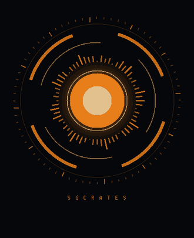
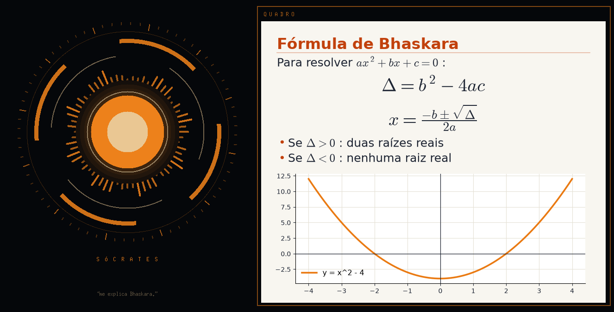

# Sócrates

Assistente de estudo por voz, em português, inspirado no Jarvis — mas com o método
de Sócrates: em vez de só entregar respostas, ele **pergunta** até você aprender.

<p align="center"></p>

> Status: **fase 10** — o cérebro que decide: ele entende o pedido e escolhe sozinho o que
> fazer (ler a lei oficial, dar aula, mexer no PC, pesquisar, lembrar de você), aprende com
> os próprios erros e propõe melhorias no código dele.

## Como rodar (Windows)

Precisa do [Python 3.11+](https://www.python.org/downloads/) (marque *Add to PATH* na instalação).

```powershell
git clone https://github.com/FelipeDaNight/socrates
cd socrates
python -m venv .venv
.venv\Scripts\python -m pip install -r requirements.txt
```

Pegue uma chave grátis em <https://console.groq.com/keys> (sem cartão) e grave no `.env`
sem ela aparecer na tela:

```powershell
$k = Read-Host "Cole a chave"
Set-Content .env "GROQ_API_KEY=$k"
cls
```

Teste o som uma vez e depois converse:

```powershell
.venv\Scripts\python main.py --diagnostico
.venv\Scripts\python main.py
```

Para abrir com dois cliques: `.venv\Scripts\python main.py --atalho` cria um atalho
"Sócrates" na Área de Trabalho.

## Como usar

Não tem botão. Ele fica ouvindo e só responde quando você diz o nome:

- **"Sócrates, o que é crase?"** ou **"O que é crase, Sócrates?"**
- **"Sócrates"** sozinho: ele responde "Sim?" e espera o pedido.
- Depois que ele responde, você tem **15 segundos** para continuar a conversa sem
  repetir o nome (no modo prova são **45**, para dar tempo de pensar na resposta).
- **"Obrigado"** encerra o assunto: ele volta a esperar o nome.

Conversa de outras pessoas e TV sem o nome dele são ignoradas. Enquanto ele fala,
o microfone fica pausado, para ele não ouvir a própria voz. Digitar e dar Enter
também funciona.

| Falado              | Digitado    | O que faz                                           |
|---------------------|-------------|-----------------------------------------------------|
| "modo explicar"     | `/explicar` | Explica o assunto e confere se você entendeu        |
| "modo prova"        | `/testar`   | Vira examinador: perguntas estilo banca, com pistas |
| "limpar conversa"   | `/limpar`   | Esquece a conversa atual e apaga o quadro           |
| "apaga o quadro"    | `/apagar`   | Apaga só o quadro branco                            |
| "obrigado"          | `/dormir`   | Encerra o assunto; volta a esperar o nome           |
| "encerrar"          | `/sair`     | Desliga o Sócrates                                  |

### O cérebro que decide

Antes, cada fala passava por uma fila de regras fixas e a primeira que encaixava decidia
("bloco de notas + artigo 7" virava só "mostrar o artigo"). Agora a fala vai ao modelo junto
com uma caixa de ferramentas e **ele decide** o que fazer, combinando várias se precisar:

| Você fala                                                    | Ele faz                                         |
|--------------------------------------------------------------|-------------------------------------------------|
| "abre o bloco de notas e coloca o artigo 7 do CTB"           | lê o texto oficial e escreve no Bloco de Notas  |
| "e os primeiros artigos do Código Penal?"                    | põe os arts. 1 a 5 no quadro (nunca de cabeça)  |
| "lê o artigo 144 da Constituição"                            | busca a lei no Planalto (guardada por 7 dias)   |
| "resume o 1º capítulo de Vidas Secas; se não tiver, aprenda" | pesquisa na internet e põe o livro no autoestudo|
| "minha prova é em março" / "esquece isso"                    | guarda (ou apaga) na memória de longo prazo     |
| "você consegue ver o Claude aberto?"                         | olha as janelas e a tela, e responde            |
| "vai", "pode", "os próximos"                                 | continua o que acabou de fazer ou oferecer      |

- **Lei só com o texto oficial.** Artigo, pena e prazo vêm da lei seca do app ou da lei do
  Planalto já guardada no PC. Se não tiver o texto, ele diz que não tem.
- **Age primeiro.** Nada de "resumir ou detalhar?": ele escolhe e faz. Pergunta só quando
  errar sairia caro.
- **Memória de longo prazo** (`Documentos\Socrates\memoria.json`): data da prova,
  dificuldades, preferências. Dá para abrir e corrigir à mão.
- **Aprende com os erros.** Quando você corrige o jeito dele, ele anota uma lição
  (`licoes.json`) e segue essa regra dali em diante. Uma vez por dia ele também relê o
  próprio registro (`socrates.log`), acha onde errou e escreve lições sozinho.
- **Melhora o próprio código, com o seu OK.** O que exige mudar o código vira uma ideia em
  `melhorias.json`. Diga "manda suas ideias para o Claude" e ele as manda ao Claude (que
  programa o Sócrates); depois é só "se atualiza".
- **Chega com iniciativa.** Ao ligar, já sugere o plano do dia (revisões vencidas, próximo
  tópico, lei seca) e mostra no quadro.
- Pedido de estudo curto e claro ("questões da PRF", "me ensina furto", "meu mapa") vai
  direto ao tutor, na hora, sem gastar o limite grátis. No meio de um treino ou aula,
  "certo", "letra B" e "próximo" também. Sem internet ou no limite grátis, ele volta
  sozinho ao jeito antigo.
- Para desligar: `agente: ativo: false` no `config.local.yaml`.

### Estudar com questões reais e lei seca

O Sócrates usa o mesmo material do app [estudo-prf](https://github.com/FelipeDaNight/estudo-prf):
as provas da PRF 2021 (Cebraspe, gabarito oficial) e do CBMGO 2022 (AOCP), o CTB compilado
e a lei seca da semana. Ele baixa tudo sozinho na primeira vez; para atualizar quando o app
ganhar material novo: `main.py --material`.

| Fale                                  | O que acontece                                            |
|---------------------------------------|-----------------------------------------------------------|
| "questões da PRF"                     | 10 questões novas, uma por vez, com a questão no quadro   |
| "5 questões de trânsito da PRF"       | Só uma matéria, na quantidade que você disser             |
| "simulado de 20 questões do CBMGO"    | Sem correção até o fim; no Cebraspe, nota = certas − erradas |
| "questões que eu errei"               | Refaz as que você errou                                   |
| "lacunas do CTB" / "lacunas de hoje"  | Completa a lei em voz alta: as vencidas primeiro, depois as novas |
| "revisa meus erros"                   | Revisão espaçada: o que você errou volta em 1, 3, 7, 15... dias |
| "lê o artigo 165 do CTB"              | Texto oficial no quadro e o resumo falado ("e o 166?" também vale) |
| "pomodoro de português"               | 25 minutos; no fim ele anota o tempo estudado             |
| "como estou indo?"                    | Tempo de estudo e acertos da semana, por matéria          |
| "o que eu estudo hoje?"               | Revisões vencidas, o próximo trecho da lei e a matéria mais fraca |

Durante o treino você nem precisa dizer o nome: responda **"certo"**, **"errado"** ou
**"letra B"**. Também vale **"dica"** (sem entregar a resposta), **"explica"** (depois de
corrigir), **"repete"**, **"mostra o texto"** (abre o texto de apoio no Bloco de Notas),
**"próxima"**, **"placar"** e **"parar"**.

A correção é feita pelo **gabarito do banco**, nunca pela opinião do modelo. Quando você
pede uma explicação, o cérebro recebe a questão, o gabarito e o comentário, e é instruído a
não contradizer o gabarito. Perguntas sobre trânsito ou sobre o Código Penal ("qual a pena de
embriaguez ao volante?") vão ao cérebro junto com o **texto oficial** dos artigos mais
ligados, para ele citar o artigo em vez de inventar.

Tudo fica no seu **caderno**, em `Documentos\Socrates\caderno.json`.

**Suas questões do Gran:** coloque arquivos `.json` em `Documentos\Socrates\questoes\`, no
mesmo formato do "Copiar backup" do app, e diga "questões do Gran".

#### Mandar para a sua planilha (opcional)

O pomodoro e os treinos podem cair na **mesma planilha do Google** que o app usa (abas Horas,
Questões, Erros e Simulados), pelo mesmo script:

1. No `config.local.yaml`, a URL do script (a mesma que está nos Ajustes do app):
   ```yaml
   planilha:
     url: https://script.google.com/macros/s/.../exec
   ```
2. No `.env`, a mesma chave do app (sem colar a chave em lugar nenhum além daqui):
   ```powershell
   $k = Read-Host "Chave da planilha"; Add-Content .env "PLANILHA_CHAVE=$k"; cls
   ```
3. Teste: `.venv\Scripts\python main.py --planilha` (deve listar as suas matérias).

Sem internet, os registros ficam guardados e vão depois.

### Trilhas da PRF: aulas, direção e o que você aprendeu

O Sócrates tem oito **trilhas conferidas** montadas sobre o último edital da PRF (2021, Cebraspe),
com as leis conferidas nas fontes oficiais até novembro de 2026:

| Trilha | Tópicos | O que tem |
|---|---|---|
| Legislação de Trânsito | 15 | o CTB inteiro, conferido no texto compilado do Planalto (04/11/2026): SNT e competências da PRF, velocidades e tempo de direção, pedestres, sinalização, veículos, escolares e motofrete, habilitação, infrações, penalidades (20/30/40 pontos), medidas administrativas, processo, crimes de trânsito e Lei 5.970/1973; e as resoluções do CONTRAN em vigor (pesos e dimensões com a tolerância de 12,5% por eixo, tacógrafo, videomonitoramento, radares, placas, vidros, amarração de carga) |
| Direito Constitucional | 10 | conferida na CF atualizada (13/11/2026): poder constituinte, art. 5º com as teses do STF (domicílio, reunião, confisco), remédios, direitos sociais e greve de policial, nacionalidade pela EC 131/2023, direitos políticos, competências (trânsito é privativa da União), Executivo (posse em 5 de janeiro), segurança pública com a PEC 18/2025 aguardando promulgação, estados de defesa e sítio, ordem social |
| Direito Administrativo | 9 | organização, ato administrativo (Lei 9.784), agentes públicos e PAD (Lei 8.112), carreira de PRF (Lei 9.654 e Decreto 8.282: 120, 150 e 360 horas de cursos para promoção), poderes e poder de polícia (STF, Tema 532), licitações pela Lei 14.133, controle, responsabilidade civil (Tema 940) e princípios (SV 13) |
| Ética e Cidadania | 7 | ética e moral, ética na função pública, Código de Ética (Decreto 1.171/1994), Sistema de Gestão da Ética (Decreto 6.029/2007), LAI e Decreto 7.724 (com o Decreto 11.527/2023), conflito de interesses (Lei 12.813) e nepotismo (Decreto 7.203), governança (Decreto 9.203/2017) |
| Direitos Humanos | 4 | teoria e dimensões, a CF e os tratados (status de emenda e supralegal, SV 25, ADI 4275), DUDH e Pacto de São José (Decreto 678/1992) |
| Direito Penal | 16 | dos princípios aos crimes contra a Administração; furto e roubo pela Lei 15.397/2026, feminicídio autônomo, Lei Antifacção |
| Processo Penal | 10 | ação penal, TCO (a PRF pode lavrar: STF, 2023), prova e local de crime, busca pessoal e veicular, flagrante e custódia por videoconferência (Lei 15.358/2026), preventiva, identificação criminal, inquérito |
| Legislação Especial | 12 | Lei 5.553, ECA, hediondos, competências da PRF (Decreto 1.655 e Decreto 11.348/2023), juizados, tortura, crimes ambientais, armas, drogas, organizações criminosas e Lei Antifacção, SUSP, abuso de autoridade |

São 83 tópicos, 519 pontos-chave e 430 itens de fixação com gabarito e justificativa, e as questões
reais da PRF 2021 (os 26 itens de trânsito e os itens 46 a 50 e 86 a 120) entram no tópico certo. Questão de
prova cuja lei mudou depois (ex.: item 82, tolerância por eixo) é treinada pelo gabarito de hoje, e
o Sócrates explica que a prova antiga cobrava a regra anterior. Isso importa porque os modelos de IA
ainda trazem leis velhas: o furto passou a 1 a 6 anos (Lei 15.397/2026), a Lei Antifacção criou o
"domínio social estruturado" (20 a 40 anos), novos hediondos entraram em 2026 e a PEC da Segurança
Pública (aprovada no Senado em 3/11/2026) põe ferrovias e hidrovias federais com a PRF.

| Fale                                   | O que acontece                                             |
|----------------------------------------|------------------------------------------------------------|
| "vamos estudar processo penal"         | Aula do tópico que ele recomenda para você agora           |
| "me ensina prisão em flagrante"        | Aula de um tópico: ponto por ponto, com exemplos da rotina de um PRF |
| "o que eu estudo hoje?" / "qual o próximo passo?" | O plano do dia, juntando todas as matérias     |
| "o que eu estudo de penal?"            | O próximo passo e onde você está no edital da matéria      |
| "o que eu estudei hoje?" / "ontem" / "essa semana" | Tempo, aulas, questões, lacunas, artigos e dúvidas |
| "o que eu já aprendi?"                 | O que você domina, o que está praticando e o que ainda erra |
| "questões de drogas" / "questões de trânsito" | Itens da trilha e questões reais da prova ligadas ao tópico |
| "questões de trânsito da PRF"          | Só as questões reais da prova, daquela matéria             |
| "simulado de legislação especial"      | 20 itens misturados, corrigidos só no fim                  |
| "mostra meu mapa"                      | Abre no navegador o mapa de todas as matérias (também: `main.py --mapa`) |

**Como é a aula:** cada ponto aparece no quadro (o texto conferido) e o Sócrates explica falando
e termina com uma pergunta. Você responde ou tira a dúvida; ele corrige com base no ponto.
"Próximo" passa adiante, "repete" explica de outro jeito, "parar" pausa (e "me ensina ..." de novo
continua de onde parou). No fim, itens de fixação estilo Cebraspe, corrigidos pelo gabarito.

**Como ele decide o próximo passo:** primeiro as revisões vencidas, depois a aula que ficou pela
metade, os tópicos em que você está fraco, os que você dominava mas não pratica há mais de 30
dias, e então o próximo tópico do edital. O domínio de cada tópico vem dos seus acertos nos itens,
nas questões reais e nas lacunas dos artigos dele; respostas antigas valem menos.

Qualquer pergunta solta sobre o assunto ("qual a pena do roubo?", "concussão ou corrupção
passiva?") vai ao cérebro junto com as notas conferidas do tópico, com a instrução de não
contradizê-las.

### Autoestudo: ele estuda sozinho o edital inteiro

Enquanto o Sócrates está aberto e você está quieto, ele **estuda sozinho**: pega o próximo
assunto do edital que ainda não tem conteúdo (a PRF inteira e o CBMGO: 174 tópicos mapeados em
`socrates/estudo/planos/`), pesquisa, escreve o material, confere com outro modelo e grava. Quando
termina, segue para o próximo. O que ele aprende vira aula, questões e notas na hora.

1. **Escolhe o assunto**: primeiro o que você pediu; depois o tópico que falta, pelo peso na prova
   (Trânsito, Português, Penal...), alternando as matérias; também confere, uma lei por vez, se
   alguma mudou depois da trilha (no Planalto, as notas "Redação dada pela Lei nº ...") e atualiza
   o tópico.
2. **Pesquisa**: o texto em vigor da lei no Planalto (sem o texto riscado) e páginas da internet,
   com os sites oficiais (gov.br, leg.br, jus.br) primeiro.
3. **Escreve**: pontos, pegadinhas, itens certo/errado e as palavras para achar o tópico na fala.
4. **Confere com outro modelo**: ponto que a fonte contradiz sai; nos tópicos de lei, ponto sem
   apoio na lei também sai; item cujo gabarito não bate com a resposta do conferente sai. Se
   sobrar pouco, ele não grava e tenta de novo horas depois.
5. **Grava** em `Documentos\Socrates\trilhas\auto-*.json` e anota em
   `Documentos\Socrates\aprendizado.json`. O que veio com o Sócrates (conferido) sempre vale mais:
   o autoestudo só completa o que falta e acrescenta as mudanças de lei.

No visor, o canto de cima mostra o que ele está fazendo. Fale com ele:

| Fale | O que acontece |
|---|---|
| "o que você está aprendendo?" | O assunto de agora, quantos já fez hoje e a fila |
| "o que você aprendeu hoje?" / "essa semana" | A lista do que ele aprendeu sozinho |
| "aprende sobre crase" / "estuda pra mim o ECA" | Põe o assunto na frente da fila e avisa quando terminar |
| "me ensina teoria do fogo" (tópico que ainda não existe) | Ele explica o básico na hora e vai estudar o tópico a fundo |
| "pausa o aprendizado" / "volta a aprender" | Pausa ou retoma (vale também da próxima vez que abrir) |

Também dá para deixar ele estudando sem voz: `main.py --aprender` (até o limite do dia, Ctrl+C
para parar) ou `main.py --aprender "crimes ambientais"` (só esse assunto). Ajustes no
`config.yaml`, seção `autoestudo`: limite por dia (40), pausa entre assuntos, quais editais.

Os itens das trilhas conferidas também estão no **app do iPhone** (estudo-prf), no banco
"Sócrates · Fixação PRF": Questões > Treinar por matéria. Para atualizar o app depois de mexer nas
trilhas: `python -m socrates.estudo.exportar_app CAMINHO_DO_APP` (o número de cada item não muda,
então o progresso e os cartões do app continuam valendo).

> Ele usa os cérebros grátis na ordem Mistral, Gemini, Groq (o Groq fica livre para a conversa).
> Com a chave do Mistral no `.env` ele aprende bem mais rápido. Os tópicos do autoestudo aparecem
> com o selo "autoestudo" no mapa: são bons, mas confira na lei antes de confiar 100%.

### Ações no computador

Sem nenhuma API: quem executa é o próprio Windows. O Groq só entende o pedido.

| Exemplo                                         | O que ele faz                               |
|-------------------------------------------------|---------------------------------------------|
| "Sócrates, abre a calculadora"                  | Abre programas: Word, Excel, Chrome, Spotify, bloco de notas... |
| "Sócrates, abre o qconcursos.com"               | Abre sites                                  |
| "Sócrates, toca lo-fi pra estudar no YouTube"   | Abre a busca no YouTube (ou no Google)      |
| "Sócrates, inicia um pomodoro de 25 minutos"    | Timer que **avisa falando** quando acaba    |
| "Sócrates, quanto tempo falta?"                 | Consulta ou cancela o timer                 |
| "Sócrates, aumenta o volume"                    | Volume: aumentar, diminuir, mudo            |
| "Sócrates, anota que a prova é dia 10"          | Caderno em `Documentos\Socrates\anotacoes.md` |
| "Sócrates, abre a pasta downloads"              | Abre pastas                                 |
| "Sócrates, bloqueia a tela"                     | Bloqueia o Windows                          |
| "Sócrates, fecha o bloco de notas"              | Fecha programas do jeito normal (pergunta se há algo sem salvar) |
| "Sócrates, volta pro Chrome"                    | Traz uma janela para a frente               |
| "Sócrates, escreve um resumo de crase no bloco de notas" | Escreve e **abre** no Bloco de Notas |
| "Sócrates, resolve a questão que eu copiei"     | Lê o que você copiou com Ctrl+C             |
| "Sócrates, copia esse resumo pra mim"           | Põe o texto na área de transferência        |

### Noção da tela

- **"Sócrates, o que está aberto?"**: ele lista as janelas abertas. É rápido e não manda nada para a internet.
- **"Sócrates, o que tem na minha tela?"**, **"resolve a questão que está na tela"**,
  **"o que é esse erro?"**: ele tira um print, manda para o modelo de visão do Groq
  (`qwen/qwen3.8-27b`, com a mesma chave) e responde sobre o que viu. O print só é tirado
  quando você pede e não fica salvo.

Ele nunca fecha o terminal nem a própria janela. Para testar tudo isso de uma vez:

```powershell
.venv\Scripts\python main.py --acoes
```

Ações que apagam arquivos ou desligam o PC ficaram de fora de propósito. Programas
que ele não conhece entram no `config.yaml`:

```yaml
acoes:
  programas:
    anki: 'C:\Program Files\Anki\anki.exe'
```

### O Sócrates pede mudanças ao Claude e se atualiza

1. **"Sócrates, pede pro Claude deixar a voz mais grave."**
2. Ele confirma: *"Vou mandar para o Claude: ... Posso mandar?"*. Responda **"sim"**.
3. Ele traz o app do Claude para a frente, cola o pedido na conversa aberta e aperta Enter
   (depois devolve o que você tinha copiado). O Claude muda o código e manda para o GitHub.
4. Quando o Claude terminar: **"Sócrates, se atualiza"** → **"sim"**. Ele baixa a versão
   nova, instala o que mudou e **reinicia sozinho**.

Deixe aberta no app do Claude a conversa onde o Sócrates é desenvolvido. Para só colar,
sem enviar, use `enviar_com_enter: false`. Ações assim (mandar ao Claude, se atualizar)
**sempre pedem confirmação**; qualquer outra resposta que não seja "sim" cancela.

### Suas preferências: `config.local.yaml`

Não edite o `config.yaml`: crie um `config.local.yaml` na mesma pasta só com o que quer
mudar. Ele vale por cima do outro, não vai para o GitHub e não trava a atualização.

```yaml
voz:
  tom: "-8Hz"
visor:
  escala: 1.5
```

### Quadro branco

Quando a explicação pede algo visual (fórmula, conta passo a passo, gráfico, ou a
questão com as alternativas no modo prova), o quadro abre ao lado do visor. A fórmula
**não é lida em voz alta**: ele explica falando e diz "veja no quadro".

<p align="center"></p>

- "Sócrates, me explica a fórmula de Bhaskara"
- "Sócrates, desenha o gráfico de seno de x"
- "Sócrates, apaga o quadro"

### Perguntas do dia a dia

O modelo foi treinado até 2024, mas o Sócrates sabe a **data, a hora e a sua cidade**
(`local:` no `config.yaml`) e **pesquisa na internet** quando a pergunta é sobre algo atual:

- "Sócrates, qual a cotação do dólar hoje?"
- "Sócrates, vai chover amanhã?" (usa a sua cidade)
- "Sócrates, quando sai o edital da PRF?"
- "Sócrates, pesquisa o horário da farmácia do centro."

Ele avisa "Vou pesquisar isso." e responde citando a fonte pelo nome. Perguntas de
estudo ("o que é crase?") e de data e hora não gastam pesquisa. A busca é a
`browser_search` do Groq. Para conferir se a sua conta tem acesso:

```powershell
.venv\Scripts\python main.py --pesquisa
```

### O visor

| Estado     | Como fica                                         |
|------------|---------------------------------------------------|
| Dormindo   | Apagado, girando devagar: diga "Sócrates"         |
| Atento     | Aceso: pode falar sem dizer o nome                |
| Ouvindo    | As barras seguem a sua voz                        |
| Pensando   | Os anéis giram rápido                             |
| Falando    | O núcleo e as barras pulsam com a voz dele        |

**Para ele parar de falar:** clique no visor ou aperte Espaço.

Cor: diga "Sócrates, muda a cor do visor para azul" (laranja, azul, ciano, verde, roxo, rosa,
vermelho ou branco). A escolha fica guardada.

Tamanho: `escala:` no `config.yaml` (1.0 pequeno, 1.25 médio, 1.5 grande).
Sem a janela: `main.py --sem-visor` (o quadro aparece como texto no terminal). Por cima das outras janelas:
`sempre_no_topo: true` no `config.yaml`. Estudando sozinho e não quer dizer o nome
toda vez: `palavra_ativacao: false`.

### A voz

Rode o provador: ele fala a mesma frase em cada voz e diz o que colocar no `config.local.yaml`.

```powershell
.venv\Scripts\python main.py --vozes
```

| Opção                         | Como é                                      | Precisa de          |
|-------------------------------|---------------------------------------------|---------------------|
| Antonio (Edge)                | A voz atual; dá para deixar mais grave com `tom: "-8Hz"` | nada        |
| Andrew, Brian, Florian (Edge) | Vozes multilíngues, falam português com sotaque leve | nada       |
| Gemini (Sadaltager, Charon, Gacrux...) | As mais naturais, com estilo de "professor calmo" | `GEMINI_API_KEY` |

A chave do Gemini é grátis em <https://aistudio.google.com/apikey>; grave no `.env`
do mesmo jeito que a do Groq, com `Add-Content` no lugar de `Set-Content`:

```powershell
$k = Read-Host "Cole a chave do Gemini"
Add-Content .env "GEMINI_API_KEY=$k"
cls
```

Com o Gemini, o Antonio fica de **reserva automática**: se o Gemini falhar ou bater o
limite grátis, a frase sai na voz do Antonio, sem o Sócrates ficar mudo.

### Se algo não funcionar

| Sintoma                                  | O que fazer                                                   |
|------------------------------------------|---------------------------------------------------------------|
| Ele não reage quando você fala           | `sensibilidade: 2.0` no `config.yaml`; confira o microfone padrão do Windows |
| Reage a barulho à toa                    | `sensibilidade: 4.0`                                          |
| Corta você no meio da frase              | `silencio_seg: 1.8`                                           |
| Não reconhece o nome                     | Rode `--diagnostico`: a etapa 5 mostra como o Whisper escreveu |
| A conversa "fecha" rápido demais         | Aumente `janela_seg`                                          |
| Fala rápido ou devagar demais            | `velocidade: "-10%"` ou `"+15%"`                              |
| "Não consegui pesquisar agora"           | Rode `--pesquisa` e veja o motivo; para desligar: `pesquisa: ativa: false` |
| Pesquisa quando não precisava (ou o contrário) | Me conte a frase: as regras ficam em `socrates/llm/pesquisa.py` |
| "Bati no limite grátis"                  | Adicione a chave do Mistral (veja "Cérebros grátis em rodízio") e rode `--provedores` |
| Quadro não aparece                       | Rode `pip install -r requirements.txt` de novo (ele precisa do matplotlib) |
| Ver a tela ou fechar programa falha      | Rode `--acoes`: mostra qual parte falhou e por quê             |
| "Não conheço o programa"                 | Adicione em `acoes: programas:` no `config.yaml`              |
| Abriu programa quando era pergunta       | Me conte a frase: as regras ficam em `socrates/llm/acoes.py`  |
| Voz do Gemini falha                      | Ele usa o Antonio sozinho; rode `--vozes` para ver o erro      |
| "O Ollama não está aberto"               | Abra o Ollama (ícone de lhama perto do relógio) ou instale: `winget install Ollama.Ollama` |
| Modo local lento demais                  | `main.py --local --modelo qwen3.5:2b` (menor e mais rápido) |
| "Tkinter não encontrado"                 | Reinstale o Python marcando *tcl/tk and IDLE*, ou use `--sem-visor` |
| "modelo não encontrado"                  | `main.py --modelos` e copie um nome para `config.yaml`        |
| Respondeu a algo que você não disse      | Veja no `socrates.log` as linhas "descartado" e "transcrito": elas mostram a certeza do Whisper |
| "Ainda não tenho o material de estudo"   | `main.py --material` com a internet ligada                    |
| Não entendeu "letra B" no treino         | Fale "letra" antes; "bê" sozinho pode virar outra palavra    |

## Como funciona

```
microfone sempre aberto → segmentador (separa cada fala pelo silêncio)
  → Whisper no Groq → disse "Sócrates"? ou está na janela de conversa?
      não → ignora
      sim → pausa o microfone → cérebro (streaming) → frases → voz Antonio
            → reabre o microfone e a janela de conversa
```

| Peça         | Tecnologia                                   | Custo                 |
|--------------|----------------------------------------------|-----------------------|
| Ouvido       | Whisper large-v3-turbo no Groq               | grátis (com limites)  |
| Cérebro      | gpt-oss-120b no Groq (troca no config)       | grátis (com limites)  |
| Pesquisa     | browser_search do Groq (só com gpt-oss)      | depende da sua conta  |
| Ações no PC  | Python + Windows (os.startfile, teclas de volume) | local            |
| Visão da tela| qwen3.8-27b no Groq (só quando você pede)    | grátis (com limites)  |
| Quadro       | matplotlib (fórmulas em LaTeX e gráficos)    | local                 |
| Voz          | edge-tts (Antonio) ou Gemini TTS             | grátis / plano grátis |
| Som          | sounddevice + miniaudio                      | local                 |
| Visor        | Tkinter (já vem com o Python)                | local                 |

### Cérebro local: tudo pensado no seu computador

Com `cerebro: local`, o Sócrates pensa no **seu PC**, com o [Ollama](https://ollama.com):
sem chave, sem limite e sem mandar a conversa para ninguém. Um só modelo (**Qwen 3.5**) faz
a conversa, as ações no PC e a visão da tela. A pesquisa na internet usa o DuckDuckGo (sem
conta) e o resumo é feito no PC. A voz (Edge) e o ouvido (Whisper) continuam como estão.

```powershell
winget install Ollama.Ollama
.venv\Scripts\python main.py --local
```

O `--local` mede a memória do PC, escolhe o modelo (4B com 12 GB de RAM ou mais, 2B com
menos), baixa, testa a velocidade e se ele usa as ferramentas, e grava `cerebro: local` no
`config.local.yaml`. Para voltar para a nuvem: `cerebro: nuvem` no mesmo arquivo.

Sem placa de vídeo, conte com uns segundos até ele começar a falar, e respostas mais simples
que as do modelo da nuvem. Para ficar rápido, o começo do pedido (persona e ferramentas) é
sempre igual, então o Ollama não o relê a cada pergunta, e a data vai no fim.

### Cérebros grátis em rodízio

Cada serviço grátis tem um limite. O Sócrates usa vários em fila: se um bate no limite
(ou cai), o pedido vai para o próximo sozinho, e quem estourou "descansa" até liberar.

| Ordem | Serviço | Limite grátis | Chave no `.env` |
|-------|---------|---------------|-----------------|
| 1 | Groq `gpt-oss-120b` | ~8 mil tokens/min, 200 mil/dia | `GROQ_API_KEY` (obrigatória) |
| 2 | **Mistral** `mistral-medium` | **~1 bilhão de tokens/mês**, 1 pedido/s | `MISTRAL_API_KEY` |
| 3 | Gemini Flash | ~15 pedidos/min | `GEMINI_API_KEY` |
| 4 | Groq `gpt-oss-20b` | outros 8 mil/min e 200 mil/dia | (a mesma do Groq) |

As ações no PC usam outra fila (`gpt-oss-20b` → `mistral-small` → Gemini → `gpt-oss-120b`),
para não disputar o limite da conversa. A pesquisa na internet usa os dois modelos do Groq;
a visão da tela tenta Groq → Mistral → Gemini. Serviço sem chave é simplesmente pulado.

**Com o Mistral no rodízio, o limite deixa de ser problema.** Para criar as chaves (grátis,
sem cartão), grave cada uma sem ela aparecer na tela:

1. **Mistral:** entre em <https://console.mistral.ai>, escolha o plano **Experiment** (grátis;
   ele confirma pelo celular), vá em **API Keys** → **Create new key**. Em *Settings → Privacy*,
   desligue o uso dos seus dados para treino, se preferir.
2. **Gemini:** <https://aistudio.google.com/apikey> → **Create API key**.

```powershell
$k = Read-Host "Cole a chave do Mistral"
Add-Content .env "MISTRAL_API_KEY=$k"
$k = Read-Host "Cole a chave do Gemini"
Add-Content .env "GEMINI_API_KEY=$k"
cls
.venv\Scripts\python main.py --provedores
```

O `--provedores` testa cada serviço e mostra quem está OK e qual chave falta.

Cada fala que o microfone separa vai para o Whisper, mesmo sem o nome. Num lugar
com muita conversa ou TV ligada, isso gasta o limite grátis do Groq mais rápido.

## Arquitetura

```
main.py                    ponto de partida: mãos livres, texto, diagnóstico, --material, --atalho
config.yaml                nome, modos, provedores, voz, microfone, escuta, visor
socrates/
  maos_livres.py           o laço da conversa sem botão
  core/orquestrador.py     máquina de estados e histórico
  core/persona.py          a personalidade e os modos (explicar / testar)
  core/despertar.py        reconhece "Sócrates" no começo ou no fim da frase
  core/contexto.py         data, hora e cidade em cada pergunta
  llm/pesquisa.py          decide quando pesquisar e limpa a resposta para a voz
  llm/acoes.py             decide quando é ação e faz o vaivém com as ferramentas
  llm/rodizio.py           rodízio de cérebros grátis (Groq, Mistral, Gemini)
  llm/ollama.py            cérebro local (Ollama): streaming, ferramentas e visão no seu PC
  ferramentas/busca.py     pesquisa no DuckDuckGo, sem chave (modo local)
  instalar_local.py        main.py --local: escolhe, baixa e testa o modelo local
  ferramentas/computador.py  as ações no PC (programas, sites, volume, timer, anotações)
  ferramentas/janelas.py   janelas, área de transferência e bloco de notas (via PowerShell)
  ferramentas/tela.py      print da tela + modelo de visão
  ferramentas/claude.py    pedir mudanças ao Claude e se atualizar (git pull + reinício)
  core/quadro_fluxo.py     separa o quadro branco da fala
  visor/quadro.py          desenha o quadro (fórmulas, gráficos com avaliação segura)
  tts/gemini.py            voz do Gemini; tts/reserva.py troca para o Edge se falhar
  core/narrador.py         fala frase a frase, sintetizando a próxima em paralelo
  core/comandos.py         comandos falados ou digitados
  audio/escuta.py          microfone sempre ligado, numa thread, com pausa
  audio/microfone.py       segmentador: separa as falas e reaprende o ruído da sala
  audio/alto_falante.py    toca a voz e avisa o visor do volume
  visor/janela.py          a janela laranja (Tkinter)
  visor/painel.py          estado compartilhado entre o Sócrates e o visor
  estudo/tutor.py          entende "questões da PRF", "lacunas do CTB", "como estou indo?"
  estudo/treino.py         a sessão de treino: pergunta, corrige pelo gabarito, placar
  estudo/respostas.py      entende "letra Bê", "acho que é errado", e confere lacunas
  estudo/caderno.py        revisão espaçada e histórico (Documentos\Socrates\caderno.json)
  estudo/lei.py            acha o artigo pedido e os trechos que respondem uma dúvida
  estudo/material.py       baixa os bancos do app estudo-prf
  estudo/planilha.py       manda para a planilha do Google (mesmo script do app)
  estudo/trilhas/*.json    trilhas conferidas da PRF (Trânsito, Penal, Processo Penal, Legislação Especial)
  estudo/planos/*.json     o mapa dos editais (PRF e CBMGO) e o endereço oficial de cada lei
  estudo/trilha.py         lê a trilha (e junta o que o autoestudo aprendeu), acha o tópico na fala
  estudo/plano.py          lê os editais e acha o tópico pedido
  estudo/autoestudo.py     estuda sozinho: escolhe, pesquisa, escreve, confere com outro modelo, grava
  estudo/leitor_lei.py     lê a lei no Planalto, tira o texto riscado e separa os artigos
  estudo/exportar_app.py   leva os itens das trilhas conferidas para o app estudo-prf (iPhone)
  estudo/aula.py           a aula guiada, ponto por ponto, com fixação no fim
  estudo/progresso.py      domínio por tópico, próximo passo, o que estudou e aprendeu
  estudo/mapa.py           o mapa de estudo em HTML (todas as matérias e o autoestudo)
  ferramentas/estudo.py    pomodoro que anota os minutos
  ferramentas/aparencia.py cor do visor por voz
  llm/  stt/  tts/         cérebro, ouvido e voz intercambiáveis
  core/agente.py           o cérebro que decide: a fala vai ao modelo com as ferramentas de estudo e do PC
  core/memoria.py          memória do aluno, lições e ideias de melhoria (Documentos\Socrates)
  core/reflexao.py         uma vez por dia relê o registro e escreve lições e ideias para o Claude
  tts/windows.py           voz do próprio Windows: a reserva quando o Edge falha
tests/                     642 testes, rodam sem microfone nem internet
```

## Roteiro

- [x] **Fase 0** — fundação, configuração, cérebro com streaming, modos, testes
- [x] **Fase 1** — microfone, Whisper (ouvido), voz Antonio frase a frase, comandos por voz
- [x] **Fase 1.5** — mãos livres com o nome "Sócrates", janela de conversa, visor laranja
- [x] **Fase 1.6** — sabe data, hora e cidade; pesquisa na internet quando precisa
- [x] **Fase 2** — ações no computador, quadro branco com fórmulas e gráficos, visor maior, vozes novas
- [x] **Fase 2.5** — interromper enquanto ele fala (clique ou Espaço no visor)
- [x] **Fase 3** — estudo com o material real: questões, lacunas, revisão espaçada, pomodoro e planilha
- [x] **Fase 4** — trilha de Direito Penal da PRF: aulas guiadas, direção, diário e mapa
- [x] **Fase 5** — trilhas de Processo Penal e Legislação Especial; autoestudo do edital inteiro
  (PRF e CBMGO), com conferência por outro modelo e atualização quando a lei muda
- [x] **Fase 6** — trilha de Legislação de Trânsito (CTB inteiro e resoluções do CONTRAN); "questões da PRF"
  ficam com a prova; questão com lei alterada depois da prova treina a regra de hoje
- [x] **Fase 7** — trilha de Direito Constitucional; tela de Resumos no app
- [x] **Fase 8** — trilha de Direito Administrativo (com a carreira de PRF)
- [x] **Fase 9** — trilhas de Ética e Cidadania e de Direitos Humanos: todo o bloco jurídico do edital da PRF
- [x] **Fase 10** — o cérebro que decide: entende o pedido e escolhe as ferramentas (lei oficial,
  aula, questões, PC, internet, memória); lições tiradas dos próprios erros; ideias de melhoria
  para o Claude; voz que não cala (tenta de novo e usa a voz do Windows)
- [ ] **Próximo** — Português, RLM, Informática, Física e Geopolítica; depois CBMGO

## Testes

```powershell
.venv\Scripts\python -m pytest
```
